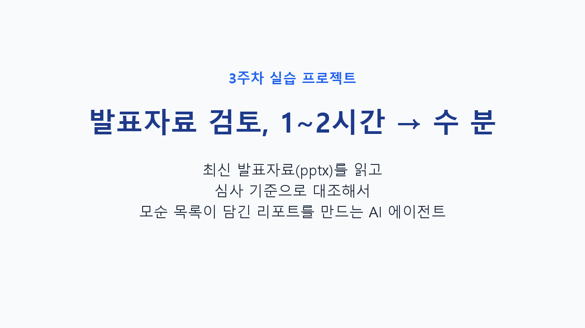

# 3주차 실습 — 발표자료 검토 에이전트 소개

▶ [소개 영상 보기 (42초)](docs/overview.mp4)

## 무엇을 하는 프로젝트인가

발표자료(pptx)는 자주 바뀌고, 바뀔 때마다 전체를 처음부터 다시 읽어야 합니다. 손으로 하면 1~2시간이 걸리고, 결론 문장과 "잠정 수치" 표기가 어긋나도 놓치기 쉽습니다.

이 프로젝트는 그 검토를 AI 에이전트에 맡기는 실습입니다. 최신 발표자료를 찾아 텍스트를 뽑고, 8개 심사 기준으로 대조한 뒤, 모순 목록이 담긴 리포트를 만듭니다.

## 흐름

1. 발표자료 폴더에서 가장 최신 pptx 파일을 고른다 (파일명의 날짜·차수 기준)
2. 슬라이드별 텍스트를 슬라이드 번호와 함께 추출한다
3. 8개 심사 기준으로 점검한다 (논리 일관성, 연구문제, 개념·지표, 자료 투명성, 방법 적합성, 결과와 해석, 한계, 데이터 융합)
4. "잠정·가정값·판정 근거 아님" 표기가 결론 문장에 스며들었는지 대조한다
5. 리포트를 만들고, 근거 슬라이드 번호로 사람이 원문을 확인한다

## 지키는 원칙

- 원본 발표자료는 읽기만 하고 수정하지 않는다
- 슬라이드에 없는 내용은 지어내지 않고 "명시되지 않음"으로 적는다
- 모순이 없으면 "0건"이라고 명시한다 (생략하지 않는다)
- 개인정보와 민감한 원자료는 검토 대상에서 뺀다
- 판정은 AI가 아니라 사람이 근거 번호로 원문을 확인하며 한다
